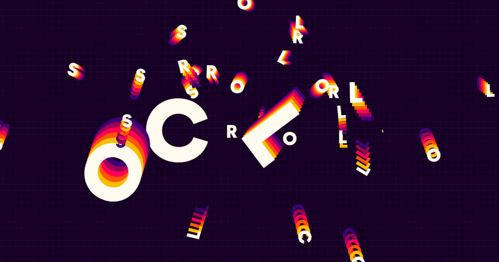

# Scroll-Driven Typography Animation with GSAP

_A playful scroll-driven typography experiment with colorful letter trails, a reactive grid and flying letters, built with GSAP and Lenis._



[Article on Codrops](https://tympanus.net/codrops/category/tutorials/)

<!-- Replace the temporary article URL and add the live demo link when Codrops confirms them. -->
Demo: coming soon.

## Installation

Install the dependencies and start the local development server:

```bash
npm ci
npm run dev
```

Create the production build:

```bash
npm run build
```

Serve the contents of `dist/` with a static web server. Asset paths are relative, so the demo can be hosted in a subdirectory.

## Credits

- [GSAP](https://gsap.com/) for the text and scroll animations.
- [Lenis](https://github.com/darkroomengineering/lenis) for smooth scrolling.

## Misc

Follow _Antoine Wodniack_: [Website](https://wodniack.dev), [LinkedIn](https://www.linkedin.com/in/wodniack/)

Follow Codrops: [X](https://x.com/codrops), [LinkedIn](https://www.linkedin.com/company/codrops/), [Instagram](https://www.instagram.com/codropsss/), [Facebook](https://www.facebook.com/codrops), [GitHub](https://github.com/codrops)

## License

[MIT](LICENSE)
